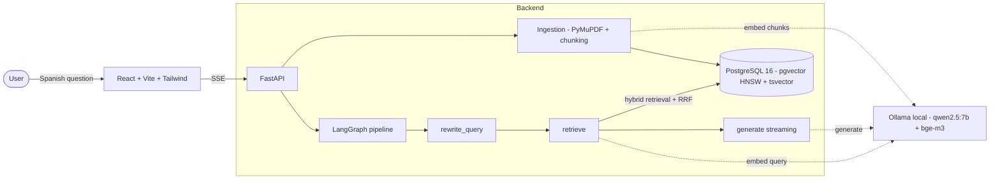

# TránsitoRAG

A full-stack **Retrieval-Augmented Generation (RAG)** demo over Peru's road-traffic
and driver's-license regulations. Ask questions in Spanish
(*"¿cuál es la multa por conducir en estado de ebriedad?"*, *"¿qué requisitos hay
para la licencia clase A?"*) and get answers with **verifiable citations** to the
exact document, page and fragment — including infraction codes and fine amounts.

Everything runs **100% locally and free** (Ollama for both the LLM and the
embeddings) and boots with a single `docker compose up`.

> ⚠️ **Disclaimer** — This is a demonstration project. It does **not** constitute
> legal advice, and the regulations shown may have changed. Always consult the
> official sources (MTC / SPIJ).

---

## What it does

- 📄 **Ingest** road-traffic PDFs (MTC regulations): parsing with PyMuPDF,
  structure-aware chunking, and embeddings — all in the background.
- 💬 **Chat in Spanish** with streaming answers, live pipeline stages
  (*Reformulando… / Buscando… / Generando…*) and inline citation chips `[n]`.
- 🔎 **Verifiable sources**: every answer cites numbered fragments; a collapsible
  side panel shows each cited chunk with its filename, page and relevance score.
- 🛡️ **Grounded & honest**: answers use only the retrieved context; when the
  corpus doesn't cover a question, the system says so instead of hallucinating.
- 📊 **Offline evaluation**: a RAGAS-style script scores faithfulness, answer
  relevancy and context precision, surfaced in an in-app dashboard.

---

## Architecture



**Request flow:** the frontend streams from `POST /api/chat` (Server-Sent Events).
The LangGraph pipeline rewrites the query (only when there's history), runs a
**hybrid retrieval** (vector + full-text, fused with Reciprocal Rank Fusion), and
streams the grounded answer token by token. Messages and cited sources are
persisted in Postgres.

Layering follows `routers → services → repositories → providers`, with
`EmbeddingProvider` / `LLMProvider` abstractions so the model backend stays
swappable.

---

## Features

> _Screenshots / GIFs placeholder — add captures of the running app here._

| | |
|---|---|
| **Streaming chat** | Live tokens rendered as Markdown, pipeline-stage indicator, clickable `[n]` citation chips. |
| **Sources panel** | Collapsible right panel; clicking a citation focuses and scrolls to the exact fragment (filename · page · score). |
| **Documents view** | Drag-and-drop PDF upload, live status polling (`processing → ready`), delete with confirmation. |
| **Evaluation dashboard** | Global metric cards + per-question table from the offline eval run. |

---

## Quickstart

**Requirements:** Docker + Docker Compose. First boot pulls the Ollama models
(~6 GB: `qwen2.5:7b` + `bge-m3`), so allow a few minutes and enough free disk.

```bash
# 1. Configure environment
cp .env.example .env

# 2. Build and start the 4 services (db, ollama, api, frontend)
docker compose up -d --build

# 3. Ingest the seed corpus (PDFs placed in data/seed_pdfs/)
make seed        # or: docker compose exec api python -m app.scripts.seed
```

Then open:

- **Frontend** → <http://localhost:5173>
- **API health** → <http://localhost:8000/health>

Other handy targets: `make test` (backend suite), `make eval` (RAGAS-style
evaluation → `backend/eval/results.json`), `make logs`, `make down`.

> The seed PDFs are **not** versioned; place the three MTC documents in
> `data/seed_pdfs/` (see [data/seed_pdfs/README.md](data/seed_pdfs/README.md)).

---

## Stack

| Layer | Technology |
|---|---|
| LLM | Ollama · `qwen2.5:7b` (good at Spanish) |
| Embeddings | Ollama · `bge-m3` (1024 dims) |
| Orchestration | LangChain + LangGraph |
| API | FastAPI + Pydantic v2, SSE streaming (Python 3.12) |
| DB / Vector store | PostgreSQL 16 + pgvector (HNSW) + full-text search (`tsvector`, Spanish) |
| Migrations | Alembic (async) |
| Frontend | React 18 + TypeScript + Vite + Tailwind + shadcn/ui + TanStack Query |
| Evaluation | Offline LLM-as-judge script → JSON |
| Infra | Docker Compose (4 services) |

---

## Technical decisions

- **pgvector over a dedicated vector DB.** One Postgres instance stores documents,
  chunks, embeddings *and* conversations, and lets us combine a vector HNSW index
  with a GIN full-text index and relational joins in a single query — no extra
  service to run or sync. Plenty for this scale; a dedicated store only pays off at
  much larger corpora.
- **Hybrid retrieval + RRF.** Vector search alone misses exact terms (infraction
  codes like `M03`, article numbers); full-text alone misses paraphrases. We take
  top-20 from each (cosine + Spanish `ts_rank`) and fuse them with **Reciprocal
  Rank Fusion** (k=60) into a top-6 — robust without a reranker.
- **bge-m3 for Spanish.** A strong multilingual embedding model that handles Spanish
  legal text well, at 1024 dims (read from the provider, never hardcoded).
- **Fully local models, and the trade-off.** No API keys, no cloud, no cost — but
  `qwen2.5:7b` runs on CPU, so the **first token** can take a while on large
  contexts (prefill is the bottleneck). Great for privacy/reproducibility; a GPU or
  a hosted model would make it snappy.
- **LangGraph pipeline.** The RAG flow is a typed graph (`rewrite_query → retrieve →
  generate`) with a conditional entry (rewrite only with history) and token-level
  custom streaming — explicit, testable, and easy to extend.
- **Page-preserving chunking.** Each page is chunked independently so every chunk
  maps to a single page, enabling precise citations. The infraction table (Anexo I)
  keeps code/description/sanction together.

---

## Evaluation

An offline script (`backend/eval/evaluate.py`) runs the **real** pipeline
(retrieval + generation) over a 25-question dataset and scores three metrics with
the local LLM as judge. Results feed the in-app dashboard (and `GET /eval/results`).

**Latest run** (`qwen2.5:7b` + `bge-m3`, 25 questions):

| Metric | Score |
|---|---|
| Faithfulness | **0.75** |
| Answer Relevancy | **0.67** |
| Context Precision | **0.80** |

The dataset (`backend/eval/dataset.jsonl`) is grounded in the real PDF content and
includes 3 out-of-corpus questions to probe anti-hallucination.

> **On RAGAS:** the plan targeted the RAGAS library, but with a 7B model on CPU it
> was impractical (many judge calls per metric, hours of compute, frequent NaN). We
> implemented an equivalent local LLM-as-judge for the same three metrics. Swapping
> in RAGAS proper is straightforward once a faster judge model is available.

---

## Roadmap

- **Cross-encoder reranker** after RRF for sharper top-k.
- **Retrieval score threshold** to strengthen the "not found" path (anti-hallucination).
- **Observability** with Langfuse (traces, latencies, token usage).
- **RAGAS** proper once a faster judge model / GPU is available.
- **Production deploy** (`docker-compose.prod.yml` with a static frontend served by nginx).

---

## Project plan

The full task-by-task plan and the decisions log live in [PLAN.md](PLAN.md).
